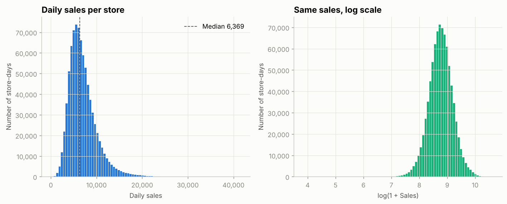
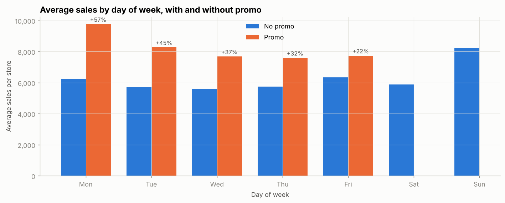
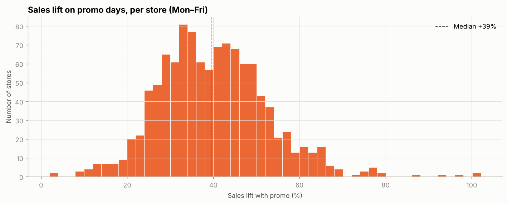
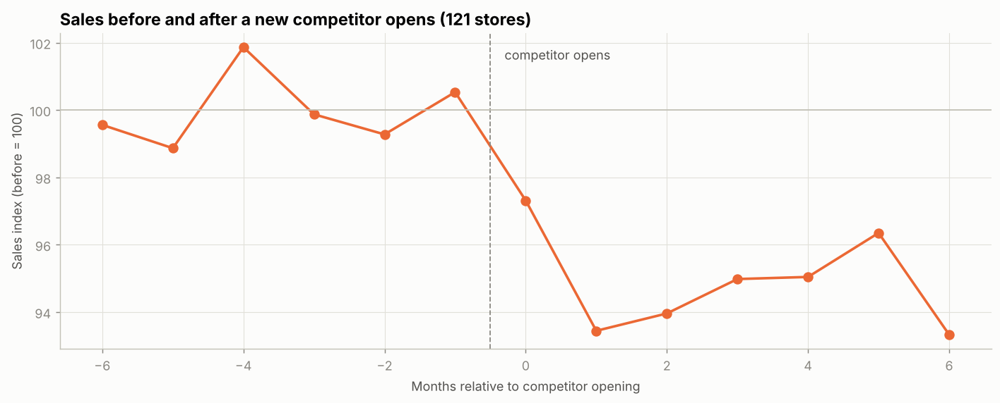
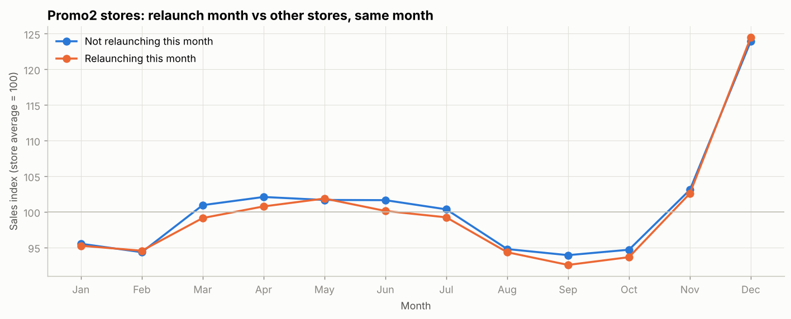
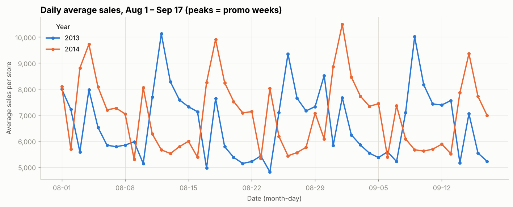
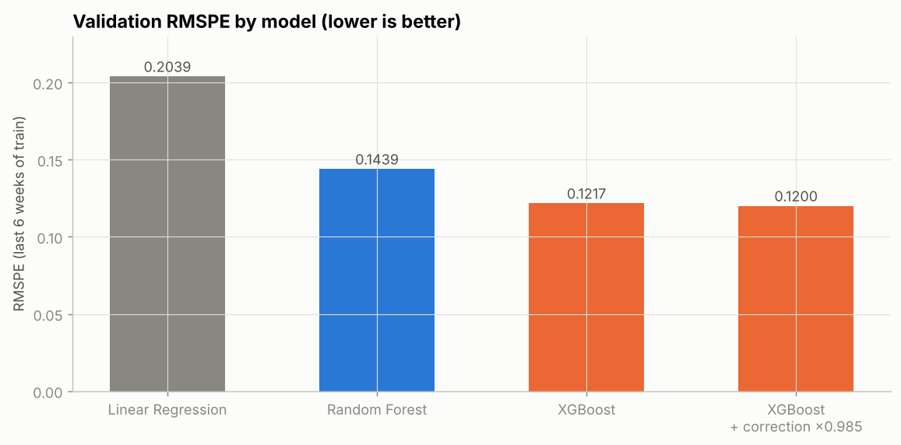
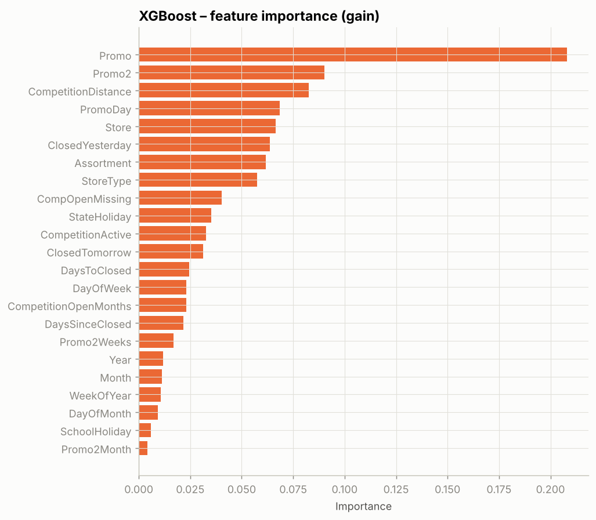
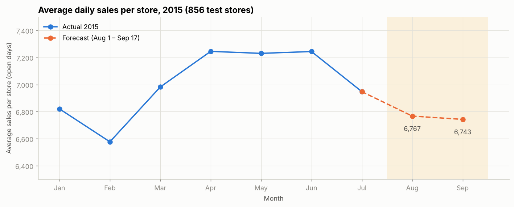

# Rossmann Store Sales Forecasting

Forecasting daily sales for **856 Rossmann drugstores** in Germany, six weeks ahead (August 1 – September 17, 2015), based on the [Rossmann Store Sales](https://www.kaggle.com/c/rossmann-store-sales) Kaggle competition.

---

## Business problem

Rossmann operates thousands of drugstores across Europe. Daily sales depend on promotions, holidays, seasonality, competition and store characteristics. Store managers need reliable forecasts to plan staff schedules, inventory and resources.

***Can we predict each store's daily sales six weeks in advance accurately enough to support planning?***

**Metric:** RMSPE (Root Mean Square Percentage Error). Days with zero sales are not scored.

---

## Dataset

- **Source:** [Kaggle – Rossmann Store Sales](https://www.kaggle.com/c/rossmann-store-sales/data). Not included in this repository; see [Getting the data](#getting-the-data).
- **Train:** 1,017,209 rows. Daily sales and customers per store, January 2013 – July 2015.
- **Test:** 41,088 rows. Days to predict (August 1 – September 17, 2015) for 856 stores, without sales.
- **Store:** 1,115 rows. Store type, assortment, competition and Promo2 information.
- **Target:** `Sales`, modeled as `log(1 + Sales)`.

---

## Methodology

### 1. Data cleaning

- Converted `Date` to datetime and `StateHoliday` to a category.
- Filled the 11 missing `Open` values in test (store 622) with 1.
- Created 4 **closure features** on train + test combined, *before* filtering, so no information is lost: `ClosedYesterday`, `ClosedTomorrow`, `DaysSinceClosed`, `DaysToClosed`.
- Merged store information.
- Handled missing values and added competition features: `CompetitionOpenMonths`, `CompetitionActive`, plus missing-data flags.
- Added Promo2 features: `Promo2Active`, `Promo2Month`, `Promo2Weeks`.
- Filtered train to open days with sales > 0 (**844,338 rows**). Test was kept complete; closed days are predicted as 0.

### 2. Exploratory data analysis

**Sales distribution.** Daily sales are right-skewed (skewness ≈ 1.6). A log transform makes them almost symmetric, so the model predicts `log(Sales)`. This also fits a percentage-based metric.



**Day of week and promo.** Promos run Monday to Friday, every other week, on the same days for all stores. The lift is strongest on Monday (+57%) and fades through the week (+22% on Friday).



**Promo lift per store.** A typical store sells **~40% more** on promo days, but the effect varies widely, from +2% to +100%. The model has to learn a different promo effect for each store.



**Competition.** Distance to the nearest competitor alone barely explains sales: stores with a very close competitor sell more because they are in busy central areas. The real effect appears over time. When a new competitor opens, the store's sales drop by **5–7%** and stay lower.



**Promo2.** Compared within the same calendar month, stores relaunching Promo2 sell the same as Promo2 stores that are not. **The relaunch month does not increase sales.**



**August–September (the forecast period).** In 2013 and 2014, this period sold about 3% less than June–July (summer holidays). Daily sales follow the promo calendar, with peaks in promo weeks, rather than the calendar date.



### 3. Feature selection

23 features, all known in advance for the forecast period:

| Group | Features |
|---|---|
| Store | `Store`, `StoreType`, `Assortment` |
| Calendar | `DayOfWeek`, `Year`, `Month`, `WeekOfYear`, `DayOfMonth` |
| Promo | `Promo`, `PromoDay` |
| Holidays | `StateHoliday`, `SchoolHoliday` |
| Closures | `ClosedYesterday`, `ClosedTomorrow`, `DaysSinceClosed`, `DaysToClosed` |
| Competition | `CompetitionDistance`, `CompetitionOpenMonths`, `CompetitionActive`, `CompOpenMissing` |
| Promo2 | `Promo2`, `Promo2Weeks`, `Promo2Month` |

`Customers` was excluded: it is not available for the forecast period (data leakage).

### 4. Modeling

- **Validation:** the last 6 weeks of train (June 19 – July 31, 2015), mimicking the real forecast horizon.
- **Models:** Linear Regression (one-hot encoding + scaling), Random Forest and XGBoost, all trained on `log(1 + Sales)`.
- **Correction factor:** multiplying predictions by 0.985 lowers RMSPE, because the metric penalizes over-prediction more than under-prediction.
- **Final model:** XGBoost retrained on the full train set (train + validation).

---

## Results

### Model comparison

| Model | Validation RMSPE |
|---|---|
| Linear Regression | 0.2039 |
| Random Forest | 0.1439 |
| XGBoost | 0.1217 |
| **XGBoost + correction factor (×0.985)** | **0.1200** |



### XGBoost tuning

One parameter changed at a time from the initial configuration:

| Experiment | RMSPE | RMSPE ×0.985 | Trees |
|---|---|---|---|
| **Baseline** | **0.1217** | **0.1200** | 1198 |
| `colsample_bytree` 0.5 | 0.1222 | 0.1207 | 1876 |
| `learning_rate` 0.05 | 0.1228 | 0.1213 | 2178 |
| `min_child_weight` 10 | 0.1234 | 0.1220 | 1370 |
| `max_depth` 8 | 0.1260 | 0.1238 | 1068 |
| Without `Promo2Month` / `SchoolHoliday` | 0.1250 | 0.1239 | 1305 |

None of the changes beat the baseline, so it was kept: `max_depth=10`, `learning_rate=0.1`, `subsample=0.9`, `colsample_bytree=0.7`, `min_child_weight=3`, 1,250 trees.



### Forecast: August – September 2015

Average daily sales per store (open days, August 1 – September 17):

| | Stores | Jun–Jul | Aug | Sep | Aug–Sep vs Jun–Jul |
|---|---|---|---|---|---|
| 2013 (actual) | 856 | 6,608 | 6,503 | 6,308 | −3.1% |
| 2014 (actual) | 676* | 6,992 | 6,669 | 6,910 | −2.9% |
| **2015 (forecast)** | 856 | 7,096 | **6,767** | **6,743** | **−4.8%** |

\* *180 stores have no data for the second half of 2014, so this group differs from the other years.*



---

## Key findings

1. **XGBoost** predicts daily sales with an RMSPE of **0.120** on the validation period, against 0.204 for linear regression.
2. **Store identity and the daily promo** are the strongest drivers. The promo lifts sales ~40%, with a large variation between stores.
3. **Closures matter:** sales are ~20% higher the day after a store was closed.
4. **New competitors** reduce a store's sales by 5–7%. **Promo2 relaunches** have no measurable effect.
5. The **forecast is consistent with history**: it captures the summer slowdown and the downward trend seen in July 2015. It may be slightly pessimistic, since the predicted drop (−4.8%) is larger than in 2013 and 2014.

---

## Limitations and next steps

**Limitations**
- 180 stores have no data for the second half of 2014.
- The validation period (June–July) differs seasonally from the forecast period (August–September).
- The correction factor was chosen on the validation set, so its gain is slightly optimistic.

**Next steps**
- Add store-level features, such as historical average sales or promo lift per store, computed only on training data.
- Add the position within the 2-week promo cycle and days to month-end (payday effect).
- Try LightGBM and blend several models.

---

## Project structure

```
store-sales-prediction/
├── README.md
├── salespredictions.ipynb      # full workflow: cleaning, EDA, models, forecast
├── requirements.txt
├── data/                       # Kaggle data (not tracked, see data/README.md)
│   └── clean/                  # cleaned parquet files generated by the notebook
└── images/
    ├── 01_sales_distribution.png
    ├── 02_sales_by_day_of_week.png
    ├── 03_promo_lift_per_store.png
    ├── 04_competitor_opening.png
    ├── 05_promo2_relaunch.png
    ├── 06_aug_sep_daily.png
    ├── 07_model_comparison.png
    ├── 08_xgb_feature_importance.png
    └── 09_forecast_vs_history.png
```

---

## How to run

1. Clone the repository:
   ```bash
   git clone https://github.com/silvigattino/store-sales-prediction.git
   cd store-sales-prediction
   ```
2. Install the dependencies:
   ```bash
   pip install -r requirements.txt
   ```
3. Download the data (see [Getting the data](#getting-the-data)) into `data/`.
4. Open `salespredictions.ipynb`, update `base_path` in the data loading cell to your local `data/` folder, and run all cells.

### Getting the data

1. Download `train.csv`, `test.csv` and `store.csv` from the [Kaggle competition page](https://www.kaggle.com/c/rossmann-store-sales/data). You need a Kaggle account and must accept the competition rules.
2. Save them in `data/` as `train_salespredictions.csv`, `test_salespredictions.csv` and `store_salespredictions.csv`.

---

## Tools

Python · pandas · NumPy · Matplotlib · scikit-learn · XGBoost · Jupyter

---

## References

- [Rossmann Store Sales – Kaggle competition](https://www.kaggle.com/c/rossmann-store-sales)
- [XGBoost documentation](https://xgboost.readthedocs.io/)
